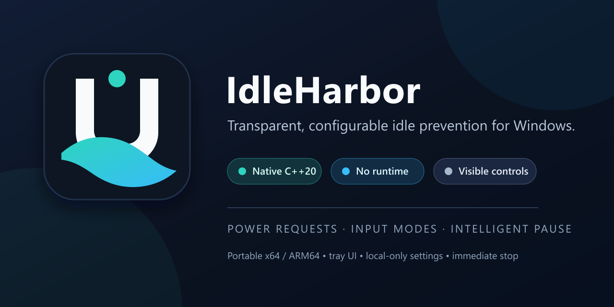
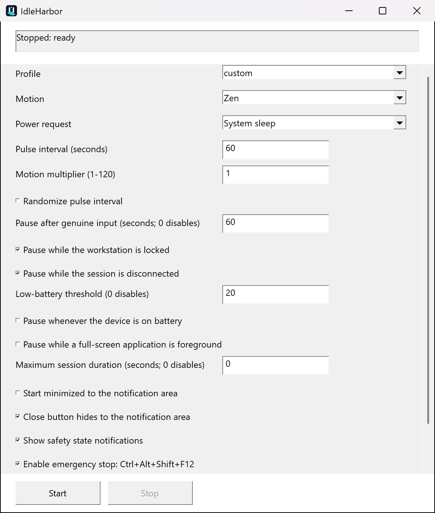
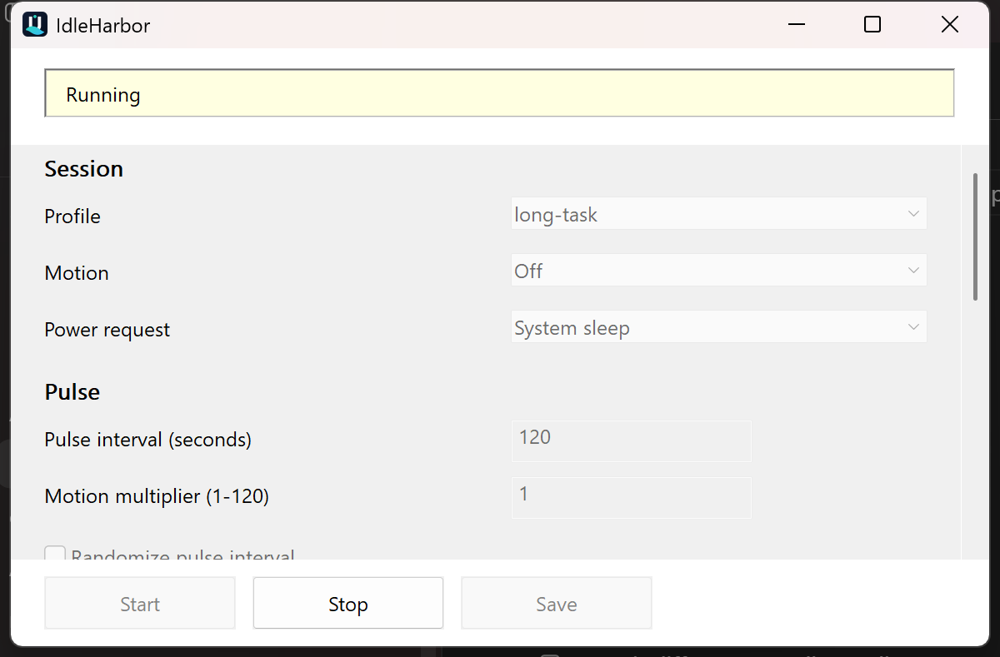
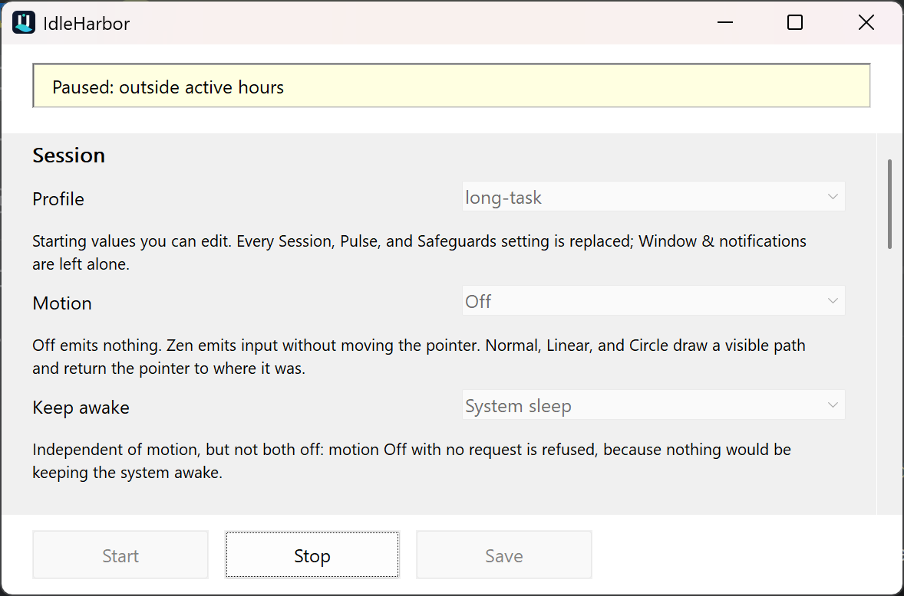
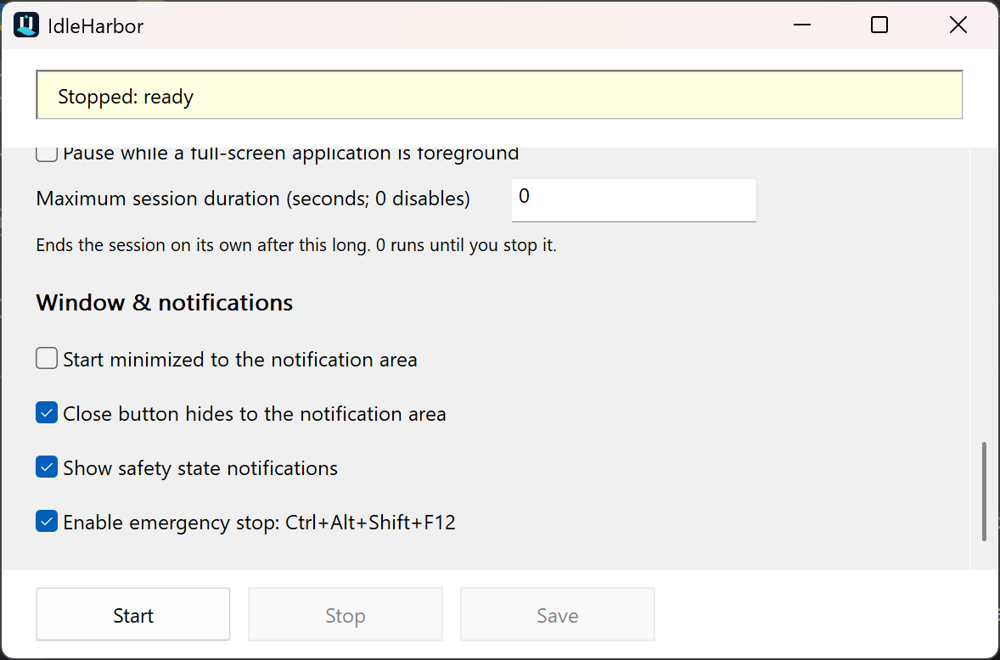
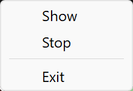
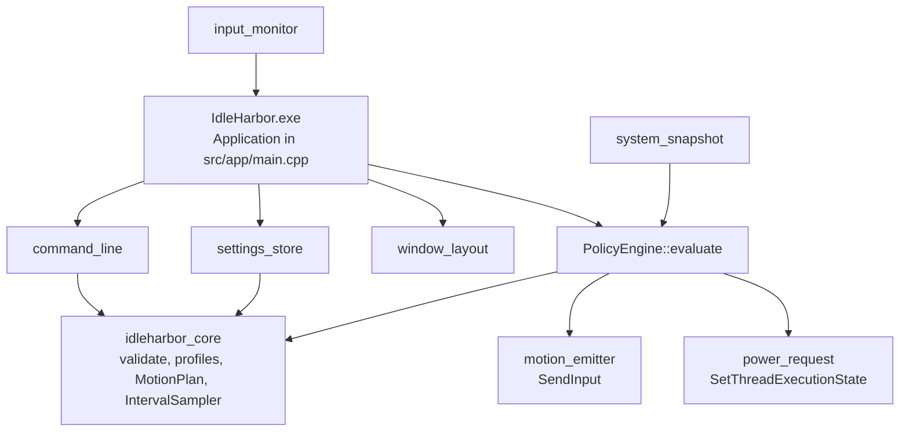

# IdleHarbor

A native Windows utility that keeps a session awake with bounded pointer motion, a Windows power request, or both, and always leaves the status and the stop path visible.

[](https://github.com/Chris0Jeky/IdleHarbor/actions/workflows/ci.yml)
[](https://github.com/Chris0Jeky/IdleHarbor/actions/workflows/codeql.yml)
[](LICENSE)
[](CMakeLists.txt)

**[Project site](https://chris0jeky.github.io/IdleHarbor/)** ·
**[v0.2.0 release](https://github.com/Chris0Jeky/IdleHarbor/releases/tag/v0.2.0)**



## What it is

IdleHarbor is a small C++20/Win32 program for work sessions that legitimately need the machine to stay available: a long local install, a presentation, a transfer you are watching. Motion and power are separate choices. You can jiggle, ask Windows to hold the system or the display, do both, or refuse the one combination that does neither.

It is not a hidden presence tool. The window, tray icon, status reason, and Stop control stay available. Injected input is tagged so IdleHarbor's own hooks ignore it; other software can still detect, block, log, or ignore it. The desktop app has no network client and no telemetry. The public website is a separate static site and is the only place the Pulseboard SDK runs.

The screenshots below are captures of the published `v0.2.0` x64 binary at 200% display scaling, checked by [`docs/assets/capture-manifest.json`](docs/assets/capture-manifest.json). They are not mocks. `main` has since moved to a compact, duration-first window (see [Status and roadmap](#status-and-roadmap)); those source changes are not in the published archives or in these images.

<p align="center">
  
</p>

| Running | Paused |
| --- | --- |
|  |  |

<p align="center">
  
</p>

<p align="center">
  
</p>

The published tray menu is Show, Stop, and Exit. On current `main`, the same menu also offers Start for, Pause or Resume, Snooze for, and Add 15 minutes or Add 1 hour. That menu is unreleased.

## Features

All of this is in the tree today. Items marked unreleased are on `main` and still versioned `0.2.0`; they are not in the GitHub release assets.

- **Independent mechanisms.** Motion is Off, Normal, Zen, Circle, or Linear. Power is None, System (`ES_CONTINUOUS | ES_SYSTEM_REQUIRED`), or Display (those flags plus `ES_DISPLAY_REQUIRED`). Off together with None is rejected: it would not keep anything awake.
- **Seven profiles.** Named presets in `settings_for_profile`. Changing profile resets session settings and leaves window and notification preferences alone.
- **Safeguards, one decision point.** `PolicyEngine::evaluate` maps genuine input, lock, disconnect, battery, fullscreen, active hours, and maximum duration onto Run, Pause, or Stop, each with a reason. Manual pause and snooze are reasons too.
- **Bounded motion.** Size is a 1–120 scale, not a pixel radius. Visible plans stay around a safe anchor and return the cursor to the captured origin. The pulse is skipped if real movement has already moved that origin. Zen sends a marked virtual move intended not to shift the visible pointer.
- **Visible session control.** Start, Stop, and Save stay outside the scrolling settings body. The tray and `Ctrl+Alt+Shift+F12` (on by default, saved as `emergency_hotkey`) stop a session. A second process forwards one command to the owner through a size-limited `WM_COPYDATA` payload; the owner holds `Local\IdleHarbor.Singleton.v1`.
- **Session timers on `main` (unreleased).** Tray **Start for** 15, 30, 60, or 120 minutes, plus Pause, Resume, Snooze for 5, 15, or 30 minutes, and Add 15 minutes or Add 1 hour. The same actions exist as `--start-for`, `--pause`, `--resume`, `--snooze`, and `--extend`. They do not write the INI. Snooze is at most 24 hours. A timed session is at most 30 days. Extend does not revive an expired session or add a limit to an unlimited one. Pause and snooze keep the overall clock running; Resume rechecks every safeguard. If releasing the power request fails, automatic activity stops, Stop stays available to retry, and a new session is blocked until cleanup succeeds.
- **Local settings only.** Validated INI, atomic temp-file-then-replace save. Portable mode writes `IdleHarbor.ini` beside the executable. Otherwise the file is `%LOCALAPPDATA%\IdleHarbor\settings.ini`. `--config PATH` is resolved by the owning instance. Unknown keys are ignored; invalid values fall back conservatively.
- **Compact window on `main` (unreleased).** Session duration leads: Until stopped, 15 minutes, 30 minutes, 1 hour, 2 hours, 4 hours, or an exact custom seconds field. Motion & timing, Safety pauses, and Window & notifications start collapsed, with a second line that summarises the current values. Dark appearance and an optional title-bar Mica backdrop are saved (`dark_appearance`, `soft_backdrop`, both default on). The control surface stays opaque. High contrast keeps native rendering. The published screenshots above are the earlier field-by-field layout.
- **Per-monitor DPI.** The manifest asks for PerMonitorV2. Layout, scrolling, and focus reveal are pure geometry in `window_layout` and are tested without a live pointer.
- **Opt-in persistence.** The portable ZIP does not create a startup entry. `install.ps1` can add a per-user Start Menu launcher and, only when you ask, a logon task. No elevation, no service, no hidden process.

| Motion | What it does |
| --- | --- |
| Off | No pointer pulse. Useful with a power request. |
| Normal | Small visible diagonal path. CLI name: `diagonal`. |
| Zen | Marked virtual input, intended not to move the visible pointer. |
| Circle | Bounded circular path. |
| Linear | Horizontal back-and-forth path. |

| Profile | Starting point |
| --- | --- |
| Balanced | Zen, system power, 60 s interval, pause on genuine input, lock, disconnect, and battery at or below 20%. |
| Long task | Motion off, system power, 120 s interval, 4 hour maximum. The Balanced safeguards stay on. |
| Presentation | Motion off, display power (system plus display), no pause on genuine input. |
| Compatibility | Visible Normal motion, no power request, 60 s interval. |
| Visible | Circle motion, no power request. |
| Battery saver | Zen, no power request, randomized 30–120 s interval, low-battery pause at 30%. |
| Custom | The Balanced values, marked as the override profile. |

Active hours are minutes from midnight. An end earlier than the start is an overnight window.

```ini
active_hours_enabled=true
active_hours_start_minute=540
active_hours_end_minute=1080
```

The key list is in [`docs/USER_GUIDE.md`](docs/USER_GUIDE.md).

## Architecture

Three static libraries and one `WIN32` executable. Policy and geometry stay testable without a window or a real pointer.



`idleharbor_app_support` is the CLI parser, the INI store, and the layout math. `idleharbor_windows` is the only place that talks to hooks, `SendInput`, power requests, and the battery/fullscreen/session snapshot. A one-second `WM_TIMER` builds a `PolicyInput` and applies the decision: run the selected power request and the next motion plan, or clear the request on pause or stop. Hooks ignore input whose `dwExtraInfo` is `kIdleHarborInputMarker` (`"IDHBPLSE"`).

The flow, viewport contract, and release path are drawn in [`docs/ARCHITECTURE.md`](docs/ARCHITECTURE.md).

## Quickstart

Windows only. Visual Studio 2022 is what CI uses (`windows-2022`, generator `Visual Studio 17 2022`). CMake 3.21 or newer. From a developer PowerShell:

```powershell
cmake -S . -B build/x64 -G "Visual Studio 17 2022" -A x64 -DIDLEHARBOR_BUILD_TESTS=ON
cmake --build build/x64 --config Release --parallel
ctest --test-dir build/x64 -C Release --output-on-failure
```

CI builds x64, ARM64, and Win32, and runs CTest for x64 and Win32. ARM64 is compile-only. A Ninja configure is in [`AGENTS.md`](AGENTS.md):

```powershell
cmake -S . -B build -G Ninja -DCMAKE_BUILD_TYPE=Debug
cmake --build build
ctest --test-dir build --output-on-failure
```

Packaging checks, from the repo root:

```powershell
.\packaging\Test-Packaging.ps1
```

CMake registers seventeen CTest targets (`core`, `core_contracts`, `power_request`, `input_monitor_lifecycle`, `command_line`, `command_line_values`, `settings_store`, `window_layout`, `motion_math`, `system_snapshot`, `foundation`, `session_controls`, `session_commands`, `session_toolkit`, `session_menu_race`, `application_status`, `compact_ui`). Each test is a `main()` with a local `CHECK` macro. There is no test framework.

To run a published build instead of compiling:

1. Download the ZIP that matches the PC from the [v0.2.0 release](https://github.com/Chris0Jeky/IdleHarbor/releases/tag/v0.2.0): [`IdleHarbor-0.2.0-windows-x64-portable.zip`](https://github.com/Chris0Jeky/IdleHarbor/releases/download/v0.2.0/IdleHarbor-0.2.0-windows-x64-portable.zip) or [`IdleHarbor-0.2.0-windows-arm64-portable.zip`](https://github.com/Chris0Jeky/IdleHarbor/releases/download/v0.2.0/IdleHarbor-0.2.0-windows-arm64-portable.zip).
2. Check the ZIP against `SHA256SUMS.txt` on that release, then extract it.
3. Run `IdleHarbor.exe`. Confirm the status says Stopped, pick a profile and a duration, then press Start.
4. Stop with the button, the tray menu, or Ctrl+Alt+Shift+F12.

`install.ps1 -Startup None` adds a per-user Start Menu launcher and does not start at logon. Automatic startup is a separate, explicit step (`install.ps1 -Startup TaskScheduler`), and only where policy allows it. Details are in [`packaging/README.md`](packaging/README.md).

### Command line

`--help` and `--version` open dialogs. `--status` opens a status dialog. Nothing in the GUI executable writes a console. The strings below match `CommandLineHelp()` in `src/app/command_line.cpp`. The parser also accepts `--jiggle` as `--start` and `--seconds` as `--interval`; those two names are not in the help text.

```text
Commands: --start (-j), --start-for DURATION, --pause, --resume,
          --snooze DURATION, --extend DURATION, --stop, --toggle,
          --status, --show (--settings, -g), --exit
Session:  --profile balanced|long-task|presentation|compatibility|visible|battery-saver|custom
          --motion off|zen|diagonal|linear|circle   (also --mode, -o)
          --power none|system|display
          --interval DURATION (-s), --random (-r), --no-random,
          --pause-on-input DURATION, --stop-after DURATION,
          --distance N (-d), --battery-threshold 0..100,
          --pause-on-fullscreen, --no-pause-on-fullscreen,
          --close-to-tray, --no-close-to-tray
Launch:   --minimized (-m), --portable, --config PATH, --version, --help
```

Durations are seconds unless suffixed with `s`, `m`, or `h`. `--interval` is 1s to 24h. `--stop-after` and `--extend` allow up to 720h. `--pause-on-input 0` turns that safeguard off. Profile and settings overrides apply to the running owner and do not rewrite the INI; Save does. Pause, Resume, Snooze, and Extend reject settings and storage options. A storage path applies only when that process is the owner.

## Tech stack

- C++20, Unicode, `/W4 /WX /permissive-` on MSVC. Static MSVC runtime (`MultiThreaded`).
- Win32 only: `User32`, `Comctl32`, `Shell32`, `Ole32`, `Wtsapi32`, `Gdi32`, `Kernel32`. No .NET, Qt, Electron, or separately shipped C runtime.
- CMake 3.21+. CI and the release workflow use Visual Studio 2022 on `windows-2022`.
- Resources: per-monitor-DPI manifest, icon, and version resource. The version string is `0.2.0` in `CMakeLists.txt`, `include/idleharbor/version.hpp`, `resources/IdleHarbor.rc`, and `resources/app.manifest`.
- PowerShell for packaging, install, and regression scripts. Node for the website release contracts, the WinGet manifest contract, and `observatory/check.mjs`.
- GitHub Actions: [CI](.github/workflows/ci.yml), [CodeQL](.github/workflows/codeql.yml) (manual C/C++ build on pull requests, `main`, and weekly), [Release](.github/workflows/release.yml) on stable `vX.Y.Z` tags, [WinGet contracts](.github/workflows/winget-contract.yml), and [published checksums](.github/workflows/published-checksum.yml). Actions are pinned by commit SHA.
- Licence `GPL-3.0-only`. Releases are unsigned on purpose.

The published `v0.2.0` x64 executable is 544,256 bytes. On one Windows 11 x64 machine, three 60-second samples put the working set at 13.7 MiB stopped and 15.1 MiB during a motion-off system power session, with effectively zero CPU. That is a measurement of that binary, not a budget. Method and limits: [`docs/BENCHMARKS.md`](docs/BENCHMARKS.md).

## Status and roadmap

Published release: **v0.2.0**. Canonical page: [`v0.2.0`](https://github.com/Chris0Jeky/IdleHarbor/releases/tag/v0.2.0). It ships x64 and ARM64 portable ZIPs, `SHA256SUMS.txt`, SPDX 2.3 SBOMs, and GitHub artifact attestations. It is unsigned. Windows will show a publisher warning; the checksums, SBOMs, and attestations are the verification path. Signing waits on an identity that is not in this repo ([`HUMAN_TODO.md`](HUMAN_TODO.md) q-2).

`main` still reports version `0.2.0`. The [unreleased changelog](CHANGELOG.md) is real code: compact duration-first settings, dark appearance, optional title-bar Mica, proportional scrolling, and the session timer/pause/snooze/extend controls. It is not a new GitHub release. Published archives, the website screenshots, and the Chocolatey pin still name `v0.2.0`.

| Channel | State |
| --- | --- |
| GitHub release | Supported install source for `0.2.0`. |
| WinGet | `Chris0Jeky.IdleHarbor` **0.1.0** is in [winget-pkgs](https://github.com/microsoft/winget-pkgs/tree/master/manifests/c/Chris0Jeky/IdleHarbor/0.1.0) ([PR 421663](https://github.com/microsoft/winget-pkgs/pull/421663), merged 2026-09-24). The `0.2.0` manifests in [`packaging/winget/0.2.0`](packaging/winget/0.2.0) are prepared and not submitted. `winget install` of the public package is the 0.1.0 package, not this release. |
| Chocolatey | Package source is in [`packaging/chocolatey`](packaging/chocolatey). Publication needs the owner's Chocolatey API key (q-3). The key does not belong in the repo. |
| Scoop | No Scoop package is maintained here. |

The website at <https://chris0jeky.github.io/IdleHarbor/> loads Pulseboard SDK **3.3.1** (`observatory.lock.json`, header of `docs/pulseboard.js`). A Beta bar offers usage counts, diagnostics, and journeys. In the EEA, or while the region is unknown, only usage counts run until the visitor presses OK. Global Privacy Control or Do Not Track sends nothing. The app does not. Consent details: [`observatory/README.md`](observatory/README.md).

Open follow-ups, from the issue tracker:

- [#123](https://github.com/Chris0Jeky/IdleHarbor/issues/123) — do not treat an unreadable existing settings file as a first run.
- [#122](https://github.com/Chris0Jeky/IdleHarbor/issues/122) — reject stale genuine-input messages from an earlier process.
- [#55](https://github.com/Chris0Jeky/IdleHarbor/issues/55) — focus changes that bypass the message loop.
- [#51](https://github.com/Chris0Jeky/IdleHarbor/issues/51) — Chocolatey install, upgrade, and uninstall on a real isolated Windows machine.
- [#49](https://github.com/Chris0Jeky/IdleHarbor/issues/49), [#50](https://github.com/Chris0Jeky/IdleHarbor/issues/50), [#59](https://github.com/Chris0Jeky/IdleHarbor/issues/59) — capture portability, screenshot corners, and shared native-test setup.
- [#37](https://github.com/Chris0Jeky/IdleHarbor/issues/37) — Start Menu known-folder relocation.
- [#6](https://github.com/Chris0Jeky/IdleHarbor/issues/6) — upload the GitHub social preview. Owner account work, with Search Console (q-4).

Physical high-contrast, screen-reader speech, multi-monitor moves, and Windows 10/ARM64 execution are called out as unverified in [`PROJECT_STATE.md`](PROJECT_STATE.md). Do not read a green local CTest run as those checks.

## Safety

Use it where you are allowed to keep a machine awake. Do not use it to fake presence or to get around device policy. A managed laptop can forbid the program, the startup task, or both. Do not disable endpoint protection to make it run.

Simulated input may be detected. A power request is a request: lock state, battery policy, and organisation policy can ignore it. Read [`docs/SAFETY.md`](docs/SAFETY.md) before installing it at work.

Report vulnerabilities privately: [`SECURITY.md`](SECURITY.md).

## Documentation

- [`docs/USER_GUIDE.md`](docs/USER_GUIDE.md) — controls, profiles, CLI, INI, startup.
- [`docs/ARCHITECTURE.md`](docs/ARCHITECTURE.md) — runtime boundaries and release flow.
- [`docs/SAFETY.md`](docs/SAFETY.md) — acceptable use and trust assumptions.
- [`docs/TROUBLESHOOTING.md`](docs/TROUBLESHOOTING.md) — build, runtime, install, verification.
- [`docs/BENCHMARKS.md`](docs/BENCHMARKS.md) — footprint method for the published binary.
- [`DESIGN.md`](DESIGN.md) and [`PRODUCT.md`](PRODUCT.md) — current window and interaction contract.
- [`packaging/README.md`](packaging/README.md) — archives, per-user install, startup choices.
- [`CONTRIBUTING.md`](CONTRIBUTING.md) — how to build, test, and review.
- [`CHANGELOG.md`](CHANGELOG.md) — released and unreleased user-visible changes.
- [`THIRD-PARTY-NOTICES.md`](THIRD-PARTY-NOTICES.md) — provenance.
- [`PROJECT_STATE.md`](PROJECT_STATE.md) — milestone and what was actually executed.

## Licence

[GNU General Public License version 3 only](LICENSE) (`GPL-3.0-only`). Source checkouts and the portable archives include the full licence text.
